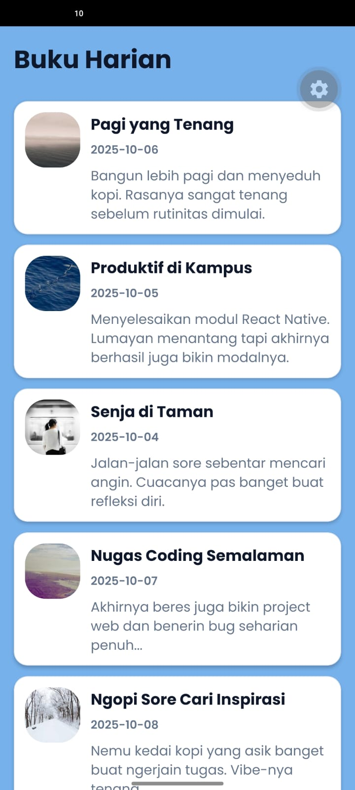
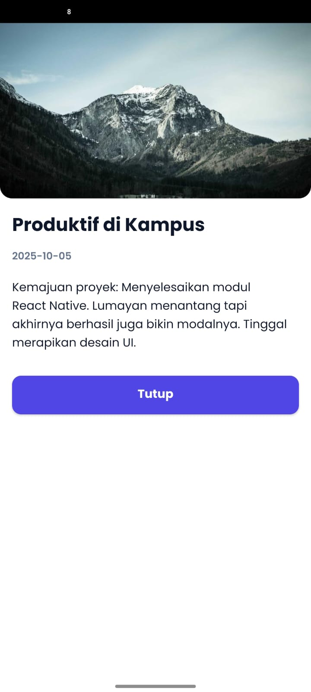

# Laporan Praktikum Pertemuan 3 - Diary App

Project ini merupakan implementasi dari tugas Praktikum Mobile Programming, berfokus pada desain UI, Flexbox, layout responsif, custom font, dan penggunaan Modal pada React Native.

## Informasi Mahasiswa
- **Nama:** Ahmad Yusuf Abdhillah
- **NIM:** 2430511042
- **Program Studi:** Teknik Informatika
- **Universitas:** Universitas Muhammadiyah Sukabumi

## Preview Aplikasi
Berikut adalah tampilan antarmuka aplikasi. Tampilan akan beradaptasi secara otomatis berdasarkan lebar layar perangkat.

  
  &nbsp; &nbsp; &nbsp; &nbsp;
  

## Fitur yang Diselesaikan
1. **Design Tokens:** Menerapkan sentralisasi style (warna, tipografi Poppins, margin, radius) pada file `tokens.js` agar UI tetap konsisten.
2. **Layout Responsif (FlatList):** Menampilkan daftar dalam 1 kolom pada ukuran layar smartphone, dan 2 kolom pada ukuran layar tablet.
3. **Interaktif & Modal:** Menggunakan komponen `Pressable` pada `DiaryCard` yang terhubung ke komponen `DiaryDetailModal` untuk menampilkan detail entri.
4. **Penambahan Entri:** Memasukkan total 5 data entri diary untuk mempermudah pengujian layout grid.

## Cara Menjalankan Project
1. Buka terminal dan lakukan clone repository:
   `git clone https://github.com/mdzzZ7/tugas-diary-app.git`
2. Masuk ke direktori aplikasi:
   `cd tugas-diary-app/diary-app`
3. Install seluruh dependensi paket:
   `npm install`
4. Jalankan development server:
   `npx expo start`

## Penjelasan Breakpoint (600px)
Aplikasi ini memanfaatkan hook `useWindowDimensions()` dari React Native untuk memantau nilai lebar (`width`) layar secara *real-time*. Nilai lebar tersebut kemudian dikomparasikan dengan konstanta `BREAKPOINTS.tablet` (600px).

- Jika lebar layar **< 600px**, variabel `twoCols` akan bernilai `false`. Komponen `FlatList` akan menggunakan properti `numColumns={1}` sehingga merender layout **1 kolom**.
- Jika lebar layar **>= 600px** (contoh: orientasi landscape atau perangkat tablet), variabel `twoCols` bernilai `true`. Komponen `FlatList` otomatis melakukan render ulang menjadi **2 kolom** untuk memaksimalkan area kosong pada layar.
